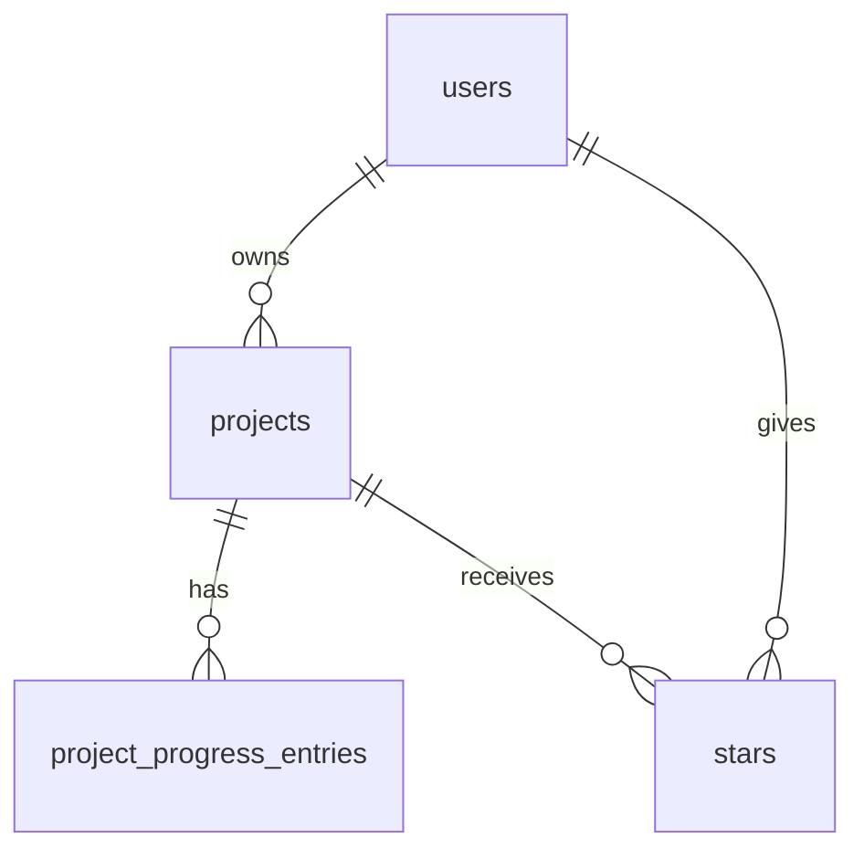

# PLAN.md: Mwedi Threads

> **Honest note on order:** a first version of Mwedi Threads was built in Replit and pushed to this repo before this plan was written. This plan records what already exists (marked **Built**) and what is still to come (marked **Planned**). Everything Planned goes through the Issue → branch → PR loop.

Mwedi Threads is the first build of **IndigoLoom**, my vision for a platform that supports a fiber artist's whole journey: discover, plan, create, connect and grow. It starts with crocheters and knitters.

## 1. Pitch

I'm building **Mwedi Threads** because a fiber artist's project inputs (patterns, designers, yarn, tools, progress notes and photos) are so spread apart that you end up creating pages everywhere and losing progress. I want one end-to-end place for the whole project journey. **I'll use it daily.**

Why now: the global knitting and crochet market is about $11B in 2026 and projected to reach $18B by 2034, 18 to 34 year olds make up 28% of it, and online craft communities passed 100M users in 2026 (IndigoLoom deck; Fiber Arts Macro Report).

## 2. Features

Numbered in build order. Features 5, 6 and 7 are my own three.

| # | Feature | User story | Status |
|---|---|---|---|
| 1 | Sign up and login | As a maker, I want to create my own account (email or Google) and log in and out, so that my projects stay private to me. | Built |
| 2 | Data model | As a maker, I want my account, projects, progress entries and stars stored in connected tables, so that everything about a project lives in one place. | Built (users table Planned) |
| 3 | Create / read / update / delete | As a maker, I want to add a project, see my list, open its detail page, edit it, and delete it after an "are you sure?" prompt, so that my journal stays accurate. | Built |
| 4 | Validation | As a maker, I want a friendly message when I leave a required field blank (project name, craft, status), so that I never save a broken record. | Built (check messages are friendly) |
| 5 | **Progress journal with photos** | As a maker, I want to add dated progress notes with an optional photo to a project, so that I never lose track of where I stopped. | Built |
| 6 | **Crochet hook-size picker** | As a crocheter, I want to choose my hook from the 20 standard sizes with mm, US and UK/Canada equivalents, so that I always record the right hook. | Built |
| 7 | **Designer link preview** | As a maker, I want to paste a designer's website and see its page title, so that I can get back to the pattern source quickly. | Built |
| 8 | Completed date | As a maker, I want a completed date that fills in automatically when I mark a project completed (and that I can edit), so that my stats reflect what really happened. | Planned |
| 9 | Stars | As a maker, I want to star my favorite projects and open a "Starred" view, so that my favorites are one click away. | Planned |
| 10 | Find things | As a maker, I want to search by project name, yarn brand and yarn color, filter by status, and sort by newest, oldest or name (A to Z), so that I can find any project fast. | Planned (status filter Built) |
| 11 | Dashboard | As a maker, I want three charts (projects by status, projects completed per month, progress entries per week) and three stats (total projects, average days from start to completion, most-used yarn brand), so that I can see my making habits. | Planned (basic dashboard Built) |

**Real data:** at least 5 of my own real projects will be in the app by the due date.

## 3. Database

| Table | Columns (type) | Primary key | Status |
|---|---|---|---|
| **users** | id (text, Clerk user ID), email (text), display_name (text), joined_at (date) | id | Planned |
| **projects** | id (uuid), owner_id (text → users), title (text), craft (knitting / crochet), status (planning / in_progress / paused / completed), description (text), pattern_name (text), pattern_designer (text), designer_website (text), designer_page_title (text), yarn (text, legacy note), yarn_brand (text), yarn_type (text), yarn_color (text), tools (text, knitting), hook_size (text, crochet), started_at (date) + started_at_precision (month / day), target_date (date) + target_date_precision (month / day), **completed_at (date, new) + completed_at_precision (month / day, new)**, completion_percent (number), created_at (date), updated_at (date) | id | Built (completed date Planned) |
| **project_progress_entries** | id (uuid), project_id (uuid → projects), notes (text), photo_path (text, optional), completion_percent (number), created_at (date) | id | Built |
| **stars** | user_id (text → users), project_id (uuid → projects), created_at (date) | (user_id, project_id) | Planned |

**How the tables connect**

- **users → projects:** one-to-many. Each project belongs to one user, and each user only sees their own.
- **projects → project_progress_entries:** one-to-many. A project has many dated progress entries.
- **users ↔ projects through stars:** many-to-many. One row means "this user starred this project."

**Date rule:** dates saved as month and year only count as the 1st of that month in any calculation.

Today projects store the Clerk user ID in `owner_id` and there is no users table yet (checked in `lib/db/src/schema/projects.ts`). The planned `users` table gets a row the first time someone signs in with Clerk.

## 4. Tests

1. **Data isolation.** Given User A has a project called "Triple Tie Cardigan," when User B logs in and opens their project list, then User B doesn't see it.
2. **Dashboard stat (most-used yarn brand).** Given a user has 2 projects using Lion Brand, 2 using Big Twist and 1 using Red Heart, when they open the dashboard, then "Most-used yarn brand" shows **Big Twist & Lion Brand**.
   - "Most-used" counts the number of projects that use a brand.
   - Brand names match regardless of capitals ("lion brand" = "Lion Brand").
   - Ties show every tied brand, listed alphabetically.

## 5. Technologies

| Choice | Why |
|---|---|
| **Replit Agent** (coding agent) | It built the first version of the app and works inside the same place it's hosted. |
| **Clerk** (sign up and login) | It gives me Google sign-in, which supports my long-term goal of a mobile app. |
| **PostgreSQL with Drizzle** (database) | Real relational tables with links between them, defined in TypeScript so the code and the database stay in sync. |
| **React with Vite** (web app) | A fast, widely used way to build the web screens. |
| **React Native with Expo** (mobile app) | Lets the same project become an iPhone and Android app later. |
| **Express API with OpenAPI and Zod** | One shared API for web and mobile, with validation that rejects bad data. |
| **Replit Deployments** (hosting, for now) | The app already runs there, so every merge can go live with the fewest moving parts. |

## 6. Design

- **Feel:** calm, cool and organized, with photos front and center.
- **Colors:**
  - Lavender `#C5D1EB`: page and card backgrounds
  - Powder Blue `#92AFD7`: highlights and selected filters
  - Blue Slate `#5A7684`: secondary text and links
  - Granite `#395B50`: main buttons and the star icon
  - Evergreen `#1F2F16`: headings and body text
- **Inspiration:**
  - **Ravelry**, for how projects and yarn connect
  - **Pinterest**, for a photo-first gallery
  - **Pocket Crochet** or **Stash2Go**, for a maker-focused mobile experience

## 7. Risks and cuts

- **Least sure I can build:** a clean designer website link (feature 7). Link previews depend on other websites, and Android still hasn't been checked.
- **Cut first if I run out of time:** the extra dashboard charts. I'd keep one chart (projects by status), which is all the assignment requires, and drop "completed per month" and "progress entries per week."

---

## Plan vs. Reality

*Filled in at the end. The plan above stays as written.*

| Planned feature | Shipped / Changed / Cut | Status (Done/Backlogged) | Learning | What changed and why (one line) |
|---|---|---|---|---|
| 1. Sign up and login | Shipped | Done | _Ngwe to write_ | Clerk email and Google sign-in, as planned. Each account gets a row in `users` on its first signed-in request (#6). |
| 2. Data model | Changed | Done | _Ngwe to write_ | The planned `users` table was added in #6 (closes #3), and the database grew from 4 planned tables to 12 as the yarn stash (#43, #47) and Sewing room (#55) were added. See schema.md. |
| 3. Create / read / update / delete | Shipped | Done | _Ngwe to write_ | The project routes were broken and rewritten first (#5, closes #4). Journal notes became editable and deletable later (#61, closes #58). |
| 4. Validation | Shipped | Done | _Ngwe to write_ | The web Edit details form let a blank name through, fixed in #50 (closes #32). Project yarn now needs a brand (#52). |
| 5. Progress journal with photos | Changed | Done | _Ngwe to write_ | Each project now picks how progress is tracked: estimate, rows or rounds, sections or skeins (#22, closes #17). |
| 6. Crochet hook-size picker | Changed | Done | _Ngwe to write_ | Widened to knitting needles with type and cable length (#26, closes #25) and an optional second hook (#60, closes #59). |
| 7. Designer link preview | Changed | Done | _Ngwe to write_ | Name / Website switch and box merged onto one row (#24, closes #23). |
| 8. Completed date | Shipped | Done | _Ngwe to write_ | Fills in when a project is finished, clears when reopened, and a date the maker picks wins (#8, closes #7). |
| 9. Stars | Changed | Done | _Ngwe to write_ | The "Starred" view became a filter chip on My projects instead of its own page (#10, closes #9). |
| 10. Find things | Changed | Done | _Ngwe to write_ | Search also matches yarn type (#41, closes #29). Sort kept "Recently updated" as the default next to newest, oldest and A to Z (#53, closes #30). |
| 11. Dashboard | Changed | Partly backlogged | _Ngwe to write_ | All three charts shipped (#12, closes #11) and the cards and bars open filtered lists (#64). Average days to finish and most-used yarn brand are still in #31. |

**Added after the plan** (not in sections 1 to 7 above)

| Feature | PR(s) | Issue |
|---|---|---|
| PLAN.md palette across the app | #14 | #13 |
| Bigger text, Lora + Figtree fonts | #16 | #15 |
| Template filler removed, sign-out menu, dashboard card tints | #19 | #18 |
| Scroll wheels for dates | #21 | #20 |
| Fix: publishing on Replit (health check) | #28 | #27 |
| Placeholder badge logo, sign-in strands removed | #36, #38 | #35, #37 |
| Landing page cleanup and About page | #39 | #34 |
| schema.md and README.md | #40 | #33 |
| Yarn Stash tab and shared yarn catalog | #43 | #42 |
| Several yarns per project, stash links, skeins-left prompts | #47 | #42, #45 |
| Mobile app catch-up (logo, tab names) | #46 | #44 |
| Fix: database updates skipped after a pull | #49 | #48 |
| Sewing room part 1: craft switches and fabric stash | #55 | #54 |
| Counter card on each project page | #57 | #56 |
| Dark mode (phone and web), mauve Sewing room | #65, #67 | #62 |
| Sewing room part 2: Overview, Projects and Tools | #68, #69 (open) | #66 |
