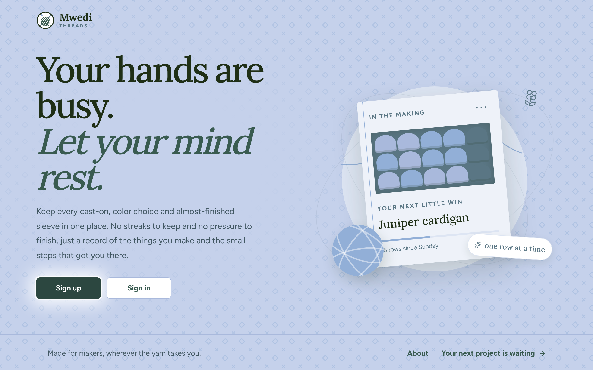
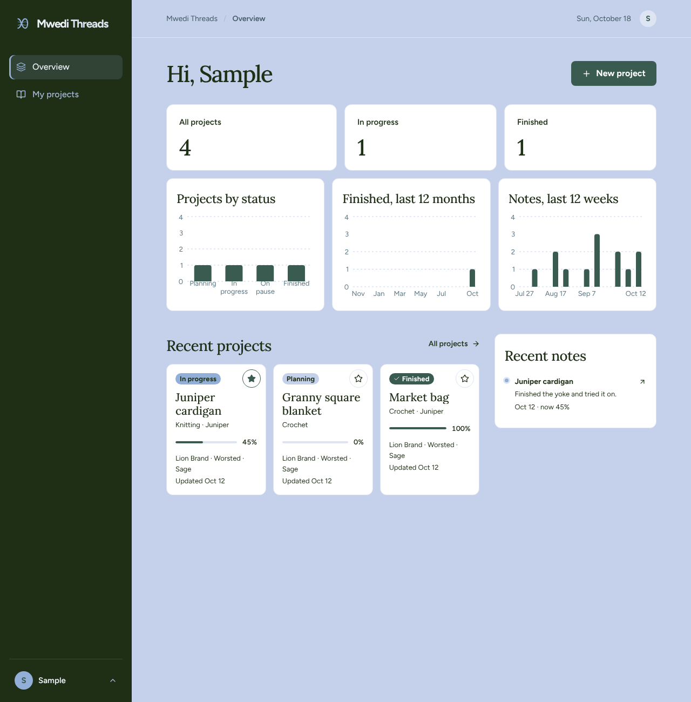
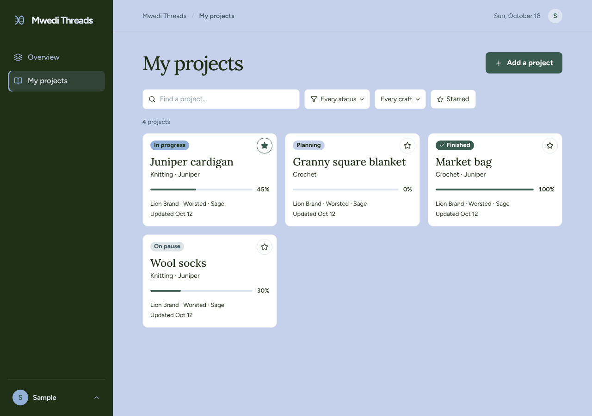
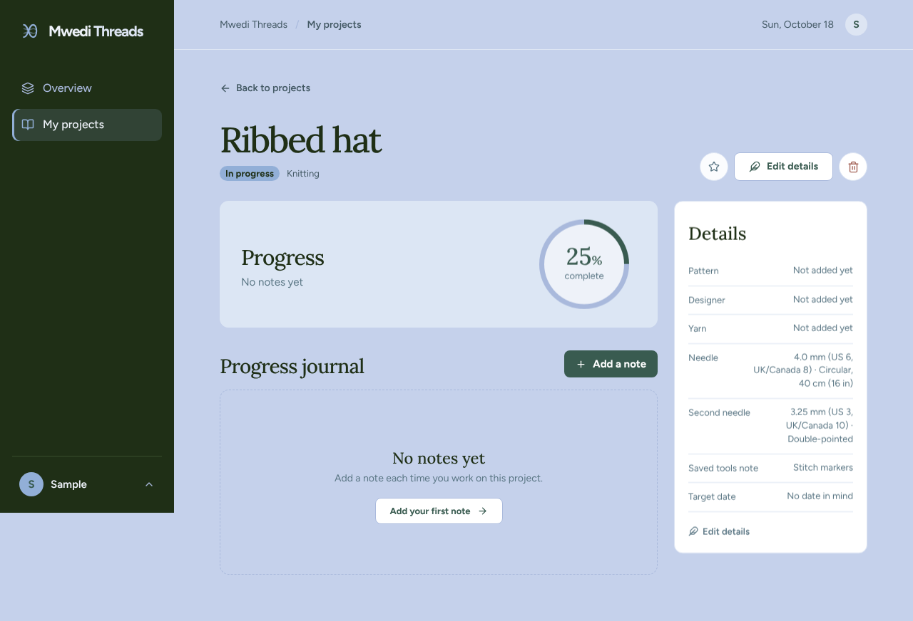

# Mwedi Threads

Mwedi Threads is a project journal for knitters and crocheters. It keeps a project's pattern, designer, yarn, tools, progress notes and photos in one place, so you always know where you stopped.

## Features

- **Sign up and sign in** with email or Google. Your projects are private to you.
- **Projects:** add, view, edit and delete knitting and crochet projects, with a friendly message when a required field is missing.
- **Project details:** pattern, designer, yarn brand, type and color, and start, target and completed dates (by day or just by month).
- **Hooks and needles:** pick a crochet hook from the standard sizes, or a main knitting needle and an optional second one with size, type and cable length. Sizes show mm, US and UK/Canada equivalents.
- **Designer link preview:** paste a designer's website and see its page title.
- **Progress tracking:** track progress as an estimate, by rows or rounds, by sections or by skeins.
- **Progress journal:** add dated notes with an optional photo to any project.
- **Completed date:** filled in automatically when a project is marked completed, and you can change it.
- **Stars:** star favorite projects and filter to just the starred ones.
- **Find projects:** search and filter by status and craft.
- **Dashboard:** project counts, and charts of projects by status, projects finished per month and notes per week.
- **Web and mobile apps** that share one API.

## Screenshots

| Dashboard | My projects |
|---|---|
|  |  |

| Project page |
|---|
|  |

## Stack

- **Web app:** React with Vite
- **Mobile app:** React Native with Expo
- **API:** Express with an OpenAPI spec and Zod validation
- **Database:** PostgreSQL with Drizzle ORM
- **Sign in:** Clerk (email and Google)
- **Hosting:** Replit
- **Workspace:** pnpm workspaces, Node.js 24, TypeScript

## Run it on Replit

Mwedi Threads is built and hosted on Replit.

1. Open the Mwedi Threads app in Replit.
2. Check that the **Secrets** tab has `DATABASE_URL`, `CLERK_SECRET_KEY` and `CLERK_PUBLISHABLE_KEY`. Replit fills in the database URL when the PostgreSQL database is added. To review yarn name merges, add `CATALOG_REVIEWER_EMAILS` with the reviewer's sign-in email.
3. Press **Run**. This starts the API server, the web app and the mobile app together.
4. Open the web app in the Preview tab, or scan the Expo QR code to open the mobile app on a phone.

**After merging a pull request on GitHub,** pull the changes into Replit. Replit then runs `scripts/post-merge.sh`, which installs packages and updates the database tables to match the schema.

**To publish,** use the **Publish** button in Replit. If a change added database columns, review the database changes when Replit asks before publishing.

## Plan

The pitch, features, database, tests, technologies and design plan are in [PLAN.md](PLAN.md).
