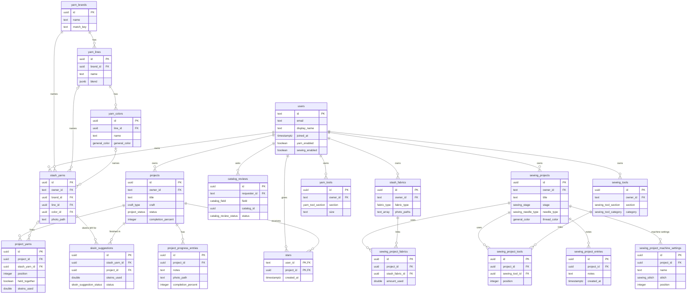

# schema.md: Mwedi Threads database

Mwedi Threads stores everything in PostgreSQL. The tables are defined with Drizzle in [`lib/db/src/schema`](lib/db/src/schema), which is the source of truth for this page.

## How the tables connect

- **users → projects:** one-to-many. Every project belongs to one user, and each user only ever sees their own projects.
- **projects → project_progress_entries:** one-to-many. A project has many dated progress notes. Deleting a project deletes its notes.
- **users ↔ projects through stars:** many-to-many. One row means "this user starred this project." Deleting either side removes the star.
- **users → stash_yarns:** one-to-many. Each maker's yarn stash is private to them.
- **Shared yarn catalog:** `yarn_brands` → `yarn_lines` (sub brands) → `yarn_colors`, built from what makers add to their stash and shared by everyone. Each stash yarn points at its brand, and at its sub brand and color when it has them.
- **projects → project_yarns:** one-to-many. A project lists every yarn it uses, one row per yarn or per color. A yarn with a brand is linked to the maker's stash, and added to the stash if it isn't there yet.
- **skein_suggestions:** when a project is finished, each linked stash yarn gets a suggestion to take the project's skeins off what's left. The maker confirms or dismisses it.
- **catalog_reviews:** a maker asking the catalog reviewer to look at how a name was merged.
- **users → stash_fabrics:** one-to-many. The Sewing room's fabric stash, separate from the yarn stash.
- **users → sewing_projects:** one-to-many. Sewing projects live apart from yarn projects.
- **sewing_projects ↔ stash_fabrics through sewing_project_fabrics:** the fabric a project uses, with how much. Removing the fabric from the stash removes the link.
- **sewing_projects ↔ sewing_tools through sewing_project_tools:** the notions and kit a project uses. Just a list: nothing is counted, and Tools quantities never change. Removing the tool removes the link.
- **sewing_projects → sewing_project_machine_settings:** one-to-many. Named sets of machine settings (such as Seams, Topstitch, Hem). Optional; deleting the project deletes them.
- **sewing_projects → sewing_project_entries:** one-to-many. A sewing project's dated notes journal. Deleting the project deletes its notes.
- **users → yarn_tools:** one-to-many. The hooks, needles and notions a maker owns, shown on the Yarn studio's Tools page. Not linked to projects.

The diagram shows the key columns only. Every column is listed below.

## users

One row per person who has signed in. A row is created the first time someone makes a signed-in request.

| Column | Type | Required | Default | Notes |
|---|---|---|---|---|
| id | text | yes | | Primary key. The Clerk user ID. |
| email | text | no | | Copied from Clerk. |
| display_name | text | no | | Copied from Clerk. |
| joined_at | timestamp with time zone | yes | now | |
| yarn_enabled | boolean | yes | true | The Yarn studio is on. |
| sewing_enabled | boolean | yes | false | The Sewing room is on. At least one of the two stays on. |
| crafts_chosen_at | timestamp with time zone | no | | Set when the person picks their crafts. A new person with nothing saved and no choice yet is asked "What do you make?". |

## projects

One row per knitting or crochet project.

| Column | Type | Required | Default | Notes |
|---|---|---|---|---|
| id | uuid | yes | random | Primary key. |
| owner_id | text | yes | | Links to `users.id`. |
| title | text | yes | | Project name. |
| craft | craft_type | yes | | `knitting` or `crochet`. |
| status | project_status | yes | `planning` | `planning`, `in_progress`, `paused` or `completed`. |
| description | text | no | | |
| pattern_name | text | no | | |
| pattern_designer | text | no | | |
| designer_website | text | no | | Link to the designer's page. |
| designer_page_title | text | no | | Page title fetched from the designer's website. |
| yarn | text | no | | Older free-text yarn note, kept for existing projects. |
| yarn_brand | text | no | | No longer used. Moved into `project_yarns` the first time the owner's projects load. |
| yarn_type | text | no | | No longer used. Moved into `project_yarns` as the sub brand. |
| yarn_color | text | no | | No longer used. Moved into `project_yarns`. |
| tools | text | no | | Older free-text tools note, shown as "Saved tools note". |
| hook_size | text | no | | Crochet hook size. |
| second_hook_size | text | no | | Optional second crochet hook, for projects that use two sizes. |
| needle_size | text | no | | Main knitting needle size. |
| needle_type | text | no | | Main needle type, such as circular. |
| needle_cable_length | text | no | | For circular or interchangeable needles. |
| second_needle_size | text | no | | Optional second needle, such as for ribbing. |
| second_needle_type | text | no | | |
| second_needle_cable_length | text | no | | |
| started_at | date | no | | |
| started_at_precision | project_date_precision | yes | `day` | `month` or `day`. |
| target_date | date | no | | |
| target_date_precision | project_date_precision | yes | `day` | `month` or `day`. |
| completed_at | date | no | | Filled in when a project is marked completed. The maker can change it. |
| completed_at_precision | project_date_precision | yes | `day` | `month` or `day`. |
| progress_method | progress_method | yes | `estimate` | `estimate`, `rows`, `sections` or `skeins`. |
| progress_total | double precision | no | | Total rows or rounds, or skeins planned. Halves allowed. |
| progress_sections | jsonb | yes | `[]` | List of `{ name, done }` for projects tracked by sections. |
| completion_percent | integer | yes | 0 | |
| counter | integer | yes | 0 | The plain counter on the project page. Never changes progress. |
| created_at | timestamp with time zone | yes | now | |
| updated_at | timestamp with time zone | yes | now | Updated on every change except the counter. |

## project_progress_entries

One row per progress note in a project's journal.

| Column | Type | Required | Default | Notes |
|---|---|---|---|---|
| id | uuid | yes | random | Primary key. |
| project_id | uuid | yes | | Links to `projects.id`. Deleted with the project. |
| notes | text | yes | | |
| photo_path | text | no | | Optional photo. |
| completion_percent | integer | yes | | Progress at the time of the note. |
| progress_value | double precision | no | | Row or round reached, or skeins used. |
| created_at | timestamp with time zone | yes | now | |

## stars

One row means "this user starred this project."

| Column | Type | Required | Default | Notes |
|---|---|---|---|---|
| user_id | text | yes | | Links to `users.id`. Deleted with the user. |
| project_id | uuid | yes | | Links to `projects.id`. Deleted with the project. |
| created_at | timestamp with time zone | yes | now | |

The primary key is the pair (`user_id`, `project_id`), so a project can only be starred once per person.

## stash_yarns

One row per yarn in a maker's stash. The brand, sub brand and color names are copied from the shared catalog when the yarn is saved.

| Column | Type | Required | Default | Notes |
|---|---|---|---|---|
| id | uuid | yes | random | Primary key. |
| owner_id | text | yes | | Links to `users.id`. Deleted with the user. |
| brand_id | uuid | yes | | Links to `yarn_brands.id`. |
| line_id | uuid | no | | Links to `yarn_lines.id`. |
| color_id | uuid | no | | Links to `yarn_colors.id`. Only set when the yarn has a sub brand. |
| brand | text | yes | | |
| sub_brand | text | no | | |
| color | text | no | | The yarn's own color name, such as "Fisherman". |
| general_color | general_color | no | | Shown as a color dot on the photo. |
| weight | yarn_weight | no | | |
| blend | jsonb | yes | `[]` | List of `{ fiber, percent }` adding up to 100. |
| brand_link | text | no | | Link to the brand's page for this yarn. |
| photo_path | text | no | | Private photo, only shown to its owner. Empty for yarn added from a project until the maker adds a photo ("Needs a photo"). |
| skeins_purchased | double precision | no | | Halves allowed. |
| skeins_left | double precision | no | | Starts at skeins purchased. Can't be more than that. |
| archived_at | timestamp with time zone | no | | Set when the maker moves used-up yarn to their Archive; empty while it's in the stash. Archived yarn stays linked to its projects and still counts on the Overview. |
| created_at | timestamp with time zone | yes | now | |
| updated_at | timestamp with time zone | yes | now | Updated on every change. |

## stash_fabrics

One row per piece of fabric in a maker's Sewing room stash. There is no shared catalog for fabric.

| Column | Type | Required | Default | Notes |
|---|---|---|---|---|
| id | uuid | yes | random | Primary key. |
| owner_id | text | yes | | Links to `users.id`. Deleted with the user. |
| fabric_type | fabric_type | yes | | |
| construction | fabric_construction | no | | Woven or knit. |
| print | fabric_print | no | | |
| general_color | general_color | no | | Shown as a color dot on the photo. |
| unit | fabric_unit | yes | `meters` | Meters go with centimeter widths, yards with inch widths. |
| amount | double precision | no | | How much was bought, to two decimals. |
| amount_left | double precision | no | | How much is still in the stash. Empty means all of it. Can't be more than `amount`. |
| width | double precision | no | | |
| pre_washed | boolean | no | | Empty when the maker hasn't said. Washing shrinks fabric, so this tells them whether the amount and width are before or after. |
| brand | text | no | | No longer asked for. A brand saved before is moved into the notes ("Brand: …") the first time the maker's fabric loads; the column can be dropped once that's done. |
| notes | text | no | | |
| photo_paths | text[] | yes | `{}` | Private photos, only shown to their owner. The first is the print close-up (required), then up to three more. |
| archived_at | timestamp with time zone | no | | Set when the maker moves used-up fabric to their Archive. Archived fabric stays linked to its projects but is left out of the Overview's stash counts. |
| created_at | timestamp with time zone | yes | now | |
| updated_at | timestamp with time zone | yes | now | Updated on every change. |

## sewing_projects

One row per sewing project in a maker's Sewing room.

| Column | Type | Required | Default | Notes |
|---|---|---|---|---|
| id | uuid | yes | random | Primary key. |
| owner_id | text | yes | | Links to `users.id`. Deleted with the user. |
| title | text | yes | | |
| status | project_status | yes | `planning` | Same statuses as yarn projects. |
| stage | sewing_stage | yes | `prep` | Prep, Cut, Sew, Fit, Finish. Finishing a project moves it to Finish. |
| pattern_name | text | no | | |
| pattern_designer | text | no | | |
| size_made | text | no | | |
| fit_changes | text | no | | |
| needle_type | sewing_needle_type | no | | Universal, ballpoint, stretch, jeans, microtex, quilting, leather, topstitch, embroidery or metallic. |
| needle_size | text | no | | One of 60/8, 65/9, 70/10, 75/11, 80/12, 90/14, 100/16, 110/18 (the API checks it). |
| thread_color | general_color | no | | The same color families as stash yarn and fabric. |
| notes | text | no | | |
| completed_at | date | no | | Set when finished, cleared on reopening. |
| created_at | timestamp with time zone | yes | now | |
| updated_at | timestamp with time zone | yes | now | Updated on every change. |

## sewing_project_fabrics

| Column | Type | Required | Default | Notes |
|---|---|---|---|---|
| id | uuid | yes | random | Primary key. |
| project_id | uuid | yes | | Links to `sewing_projects.id`. Deleted with the project. |
| stash_fabric_id | uuid | yes | | Links to `stash_fabrics.id`. Deleted with the fabric. |
| amount_used | double precision | no | | In the fabric's own unit. |
| position | integer | yes | 0 | Order on the project. |

## sewing_tools

One row per notion or piece of kit in a maker's Sewing room.

| Column | Type | Required | Default | Notes |
|---|---|---|---|---|
| id | uuid | yes | random | Primary key. |
| owner_id | text | yes | | Links to `users.id`. Deleted with the user. |
| section | sewing_tool_section | yes | | Notions or kit. |
| category | sewing_tool_category | yes | | |
| name | text | yes | | |
| quantity | integer | no | | |
| size | text | no | | |
| color | text | no | | |
| brand | text | no | | |
| notes | text | no | | |
| photo_path | text | no | | Private photo, only shown to its owner. |
| archived_at | timestamp with time zone | no | | Set when the maker moves a used-up notion to their Archive. Kit is never archived. |
| created_at | timestamp with time zone | yes | now | |
| updated_at | timestamp with time zone | yes | now | Updated on every change. |

## sewing_project_tools

| Column | Type | Required | Default | Notes |
|---|---|---|---|---|
| id | uuid | yes | random | Primary key. |
| project_id | uuid | yes | | Links to `sewing_projects.id`. Deleted with the project. |
| sewing_tool_id | uuid | yes | | Links to `sewing_tools.id`. Deleted with the tool. |
| position | integer | yes | 0 | Order on the project. |

## sewing_project_machine_settings

One row per named set of machine settings on a sewing project. Every column but the keys is optional; the API drops a set with nothing filled in.

| Column | Type | Required | Default | Notes |
|---|---|---|---|---|
| id | uuid | yes | random | Primary key. |
| project_id | uuid | yes | | Links to `sewing_projects.id`. Deleted with the project. |
| name | text | no | | Up to 60 characters, such as Seams, Topstitch or Hem. |
| stitch | sewing_stitch | no | | Straight, zigzag, 3-step zigzag, stretch, overlock, blind hem, buttonhole or decorative. |
| stitch_length | double precision | no | | mm, 0 to 5 in half steps. |
| stitch_width | double precision | no | | mm, 0 to 7 in half steps. |
| tension | double precision | no | | 0 to 9 in half steps. |
| presser_foot | sewing_presser_foot | no | | All-purpose, zipper, walking, buttonhole, blind hem, rolled hem, 1/4 inch, open toe or non-stick. |
| notes | text | no | | Up to 500 characters. |
| position | integer | yes | 0 | Order on the project. |

## sewing_project_entries

One row per dated note in a sewing project's notes journal. Notes and a date only: no photo or progress amount.

| Column | Type | Required | Default | Notes |
|---|---|---|---|---|
| id | uuid | yes | random | Primary key. |
| project_id | uuid | yes | | Links to `sewing_projects.id`. Deleted with the project. |
| notes | text | yes | | Up to 2,000 characters. |
| created_at | timestamp with time zone | yes | now | When the note was written. The maker can move it to another day, never into the future. |
| updated_at | timestamp with time zone | yes | now | |

## yarn_tools

One row per crochet hook, knitting needle or notion a maker owns in their Yarn studio. Each row belongs to one section, and only that section's columns are kept.

| Column | Type | Required | Default | Notes |
|---|---|---|---|---|
| id | uuid | yes | random | Primary key. |
| owner_id | text | yes | | Links to `users.id`. Deleted with the user. |
| section | yarn_tool_section | yes | | Hooks, needles or notions. |
| size | text | no | | Required for hooks and needles, from the same size lists projects use. Empty for notions. |
| needle_type | text | no | | Needles only: `straight`, `circular`, `double_pointed` or `interchangeable`. |
| cable_length | text | no | | Circular and interchangeable needles only. |
| material | yarn_tool_material | no | | Hooks and needles only. |
| notion_type | yarn_notion_type | no | | Required for notions. |
| name | text | no | | Optional. A notion with no name shows its type. |
| quantity | integer | no | | How many the maker owns. |
| brand | text | no | | |
| notes | text | no | | |
| photo_path | text | no | | Private photo, only shown to its owner. |
| created_at | timestamp with time zone | yes | now | |
| updated_at | timestamp with time zone | yes | now | Updated on every change. |

## project_yarns

Every yarn a project uses, in the order the maker listed them.

| Column | Type | Required | Default | Notes |
|---|---|---|---|---|
| id | uuid | yes | random | Primary key. |
| project_id | uuid | yes | | Links to `projects.id`. Deleted with the project. |
| position | integer | yes | | Order in the list, starting at 0. |
| stash_yarn_id | uuid | no | | Links to `stash_yarns.id`. Cleared if the stash yarn is removed. |
| brand | text | no | | Copied from the stash yarn when linked. |
| sub_brand | text | no | | |
| color | text | no | | |
| held_together | boolean | yes | `false` | Worked as one strand with the yarn listed just above. |
| skeins_used | double precision | no | | Halves allowed. |

## skein_suggestions

| Column | Type | Required | Default | Notes |
|---|---|---|---|---|
| id | uuid | yes | random | Primary key. |
| owner_id | text | yes | | Links to `users.id`. |
| stash_yarn_id | uuid | yes | | Links to `stash_yarns.id`. Unique together with `project_id`, so a project only takes skeins off once. |
| project_id | uuid | yes | | Links to `projects.id`. |
| skeins_used | double precision | yes | | The project's skeins of this yarn. |
| status | skein_suggestion_status | yes | `pending` | Pending suggestions are withdrawn if the project is reopened. |
| created_at | timestamp with time zone | yes | now | |

## catalog_reviews

| Column | Type | Required | Default | Notes |
|---|---|---|---|---|
| id | uuid | yes | random | Primary key. |
| requester_id | text | yes | | Links to `users.id`. |
| stash_yarn_id | uuid | no | | The yarn the maker asked from. |
| field | catalog_field | yes | | `brand`, `sub_brand` or `color`. |
| catalog_id | uuid | yes | | The `yarn_brands`, `yarn_lines` or `yarn_colors` row being reviewed. |
| current_name | text | yes | | The catalog name when the review was asked. |
| suggested_name | text | yes | | What the maker thinks it should be. |
| note | text | no | | |
| status | catalog_review_status | yes | `open` | `renamed` updates the catalog and every stash and project yarn using it. |
| reviewer_note | text | no | | Reply shown to the maker. |
| created_at | timestamp with time zone | yes | now | |
| resolved_at | timestamp with time zone | no | | |

The reviewer is set by email in the `CATALOG_REVIEWER_EMAILS` secret.

## yarn_brands, yarn_lines and yarn_colors

The shared yarn catalog. Every name has a `match_key` (lowercase letters and digits only), so "Lion Brand" and "lionbrand" are the same entry instead of a duplicate.

| Table | Columns | Notes |
|---|---|---|
| yarn_brands | id, name, match_key, created_at | `match_key` is unique. |
| yarn_lines | id, brand_id, name, match_key, blend, link, created_at | A brand's sub brands. Unique per brand and `match_key`. Blend and link come from the first maker who adds the sub brand and pre-fill the form for the next one. |
| yarn_colors | id, line_id, name, match_key, general_color, created_at | A sub brand's real color names. Unique per sub brand and `match_key`. |

## Enums

| Enum | Values |
|---|---|
| craft_type | `knitting`, `crochet` |
| project_status | `planning`, `in_progress`, `paused`, `completed` |
| project_date_precision | `month`, `day` |
| progress_method | `estimate`, `rows`, `sections`, `skeins` |
| yarn_weight | `lace`, `fingering`, `sport`, `dk`, `worsted`, `bulky`, `super_bulky`, `jumbo` |
| general_color | `red`, `orange`, `yellow`, `green`, `blue`, `purple`, `pink`, `brown`, `black`, `gray`, `white`, `cream`, `multi` |
| skein_suggestion_status | `pending`, `accepted`, `dismissed` |
| catalog_field | `brand`, `sub_brand`, `color` |
| catalog_review_status | `open`, `renamed`, `kept` |
| fabric_type | `cotton`, `linen`, `jersey`, `denim`, `silk`, `wool`, `polyester`, `blend`, `other`, `canvas`, `chambray`, `chiffon`, `corduroy`, `crepe`, `flannel`, `fleece`, `french_terry`, `rib_knit`, `satin`, `tulle`, `velvet`, `viscose` |
| fabric_construction | `woven`, `knit` |
| fabric_print | `solid`, `floral`, `stripe`, `check`, `dots`, `geometric`, `abstract`, `animal`, `novelty`, `ankara`, `batik`, `botanical`, `camo`, `chevron`, `damask`, `houndstooth`, `ikat`, `ombre`, `paisley`, `tie_dye`, `toile`, `other` |
| fabric_unit | `meters`, `yards` |
| yarn_tool_section | `hooks`, `needles`, `notions` |
| yarn_tool_material | `aluminium`, `steel`, `bamboo`, `wood`, `plastic`, `ergonomic` |
| yarn_notion_type | `stitch_markers`, `tapestry_needles`, `row_counter`, `cable_needles`, `scissors`, `measuring_tape`, `blocking_mats`, `blocking_pins`, `yarn_swift`, `ball_winder`, `other` |

## Date rule

A date saved with `month` precision means only the month and year are known. In any calculation it counts as the 1st of that month.

## Compared with the plan

Section 3 of [PLAN.md](PLAN.md) planned 4 tables: `users`, `projects`, `project_progress_entries` and `stars`. All 4 were built, with these differences:

- **users:** has the 4 planned columns (`id`, `email`, `display_name`, `joined_at`), plus the craft switches `yarn_enabled`, `sewing_enabled` and `crafts_chosen_at` added in #55. A row is created on the first signed-in request (#6).
- **projects:** has every planned column, plus `completed_at` (#8), the progress method columns (#22), the knitting needle columns (#26), `counter` (#57) and the second hook (#60).
- **project_progress_entries:** as planned, plus `progress_value` for the rows, sections and skeins methods (#22).
- **stars:** as planned, one junction table with (`user_id`, `project_id`) as the key (#10).

Tables added after the plan: `stash_yarns`, `yarn_brands`, `yarn_lines`, `yarn_colors` and `catalog_reviews` (yarn stash, #43 and #47), `project_yarns` and `skein_suggestions` (several yarns per project, #47), and `stash_fabrics` (Sewing room, #55).

