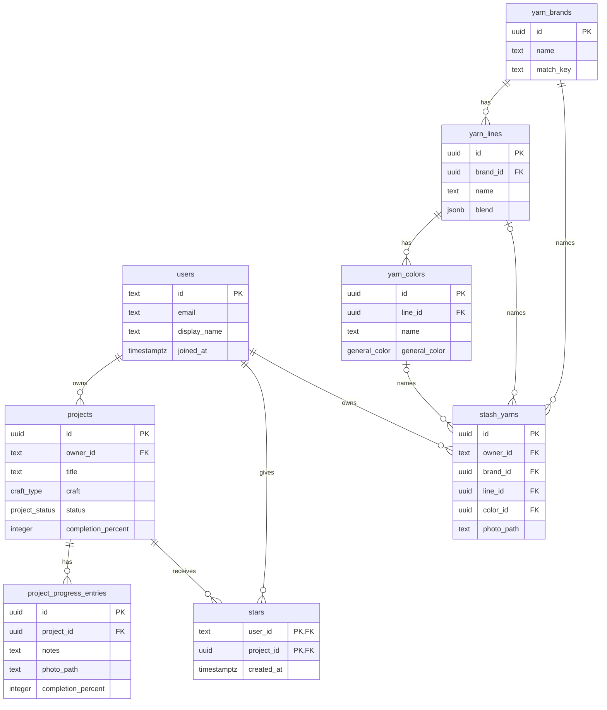

# schema.md: Mwedi Threads database

Mwedi Threads stores everything in PostgreSQL. The tables are defined with Drizzle in [`lib/db/src/schema`](lib/db/src/schema), which is the source of truth for this page.

## How the tables connect

- **users → projects:** one-to-many. Every project belongs to one user, and each user only ever sees their own projects.
- **projects → project_progress_entries:** one-to-many. A project has many dated progress notes. Deleting a project deletes its notes.
- **users ↔ projects through stars:** many-to-many. One row means "this user starred this project." Deleting either side removes the star.
- **users → stash_yarns:** one-to-many. Each maker's yarn stash is private to them.
- **Shared yarn catalog:** `yarn_brands` → `yarn_lines` (sub brands) → `yarn_colors`, built from what makers add to their stash and shared by everyone. Each stash yarn points at its brand, and at its sub brand and color when it has them.

The diagram shows the key columns only. Every column is listed below.

## users

One row per person who has signed in. A row is created the first time someone makes a signed-in request.

| Column | Type | Required | Default | Notes |
|---|---|---|---|---|
| id | text | yes | | Primary key. The Clerk user ID. |
| email | text | no | | Copied from Clerk. |
| display_name | text | no | | Copied from Clerk. |
| joined_at | timestamp with time zone | yes | now | |

## projects

One row per knitting or crochet project.

| Column | Type | Required | Default | Notes |
|---|---|---|---|---|
| id | uuid | yes | random | Primary key. |
| owner_id | text | yes | | Links to `users.id`. |
| title | text | yes | | Project name. |
| craft | craft_type | yes | | `knitting` or `crochet`. |
| status | project_status | yes | `planning` | `planning`, `in_progress`, `paused` or `completed`. |
| description | text | no | | |
| pattern_name | text | no | | |
| pattern_designer | text | no | | |
| designer_website | text | no | | Link to the designer's page. |
| designer_page_title | text | no | | Page title fetched from the designer's website. |
| yarn | text | no | | Older free-text yarn note, kept for existing projects. |
| yarn_brand | text | no | | |
| yarn_type | text | no | | |
| yarn_color | text | no | | |
| tools | text | no | | Older free-text tools note, shown as "Saved tools note". |
| hook_size | text | no | | Crochet hook size. |
| needle_size | text | no | | Main knitting needle size. |
| needle_type | text | no | | Main needle type, such as circular. |
| needle_cable_length | text | no | | For circular or interchangeable needles. |
| second_needle_size | text | no | | Optional second needle, such as for ribbing. |
| second_needle_type | text | no | | |
| second_needle_cable_length | text | no | | |
| started_at | date | no | | |
| started_at_precision | project_date_precision | yes | `day` | `month` or `day`. |
| target_date | date | no | | |
| target_date_precision | project_date_precision | yes | `day` | `month` or `day`. |
| completed_at | date | no | | Filled in when a project is marked completed. The maker can change it. |
| completed_at_precision | project_date_precision | yes | `day` | `month` or `day`. |
| progress_method | progress_method | yes | `estimate` | `estimate`, `rows`, `sections` or `skeins`. |
| progress_total | double precision | no | | Total rows or rounds, or skeins planned. Halves allowed. |
| progress_sections | jsonb | yes | `[]` | List of `{ name, done }` for projects tracked by sections. |
| completion_percent | integer | yes | 0 | |
| created_at | timestamp with time zone | yes | now | |
| updated_at | timestamp with time zone | yes | now | Updated on every change. |

## project_progress_entries

One row per progress note in a project's journal.

| Column | Type | Required | Default | Notes |
|---|---|---|---|---|
| id | uuid | yes | random | Primary key. |
| project_id | uuid | yes | | Links to `projects.id`. Deleted with the project. |
| notes | text | yes | | |
| photo_path | text | no | | Optional photo. |
| completion_percent | integer | yes | | Progress at the time of the note. |
| progress_value | double precision | no | | Row or round reached, or skeins used. |
| created_at | timestamp with time zone | yes | now | |

## stars

One row means "this user starred this project."

| Column | Type | Required | Default | Notes |
|---|---|---|---|---|
| user_id | text | yes | | Links to `users.id`. Deleted with the user. |
| project_id | uuid | yes | | Links to `projects.id`. Deleted with the project. |
| created_at | timestamp with time zone | yes | now | |

The primary key is the pair (`user_id`, `project_id`), so a project can only be starred once per person.

## stash_yarns

One row per yarn in a maker's stash. The brand, sub brand and color names are copied from the shared catalog when the yarn is saved.

| Column | Type | Required | Default | Notes |
|---|---|---|---|---|
| id | uuid | yes | random | Primary key. |
| owner_id | text | yes | | Links to `users.id`. Deleted with the user. |
| brand_id | uuid | yes | | Links to `yarn_brands.id`. |
| line_id | uuid | no | | Links to `yarn_lines.id`. |
| color_id | uuid | no | | Links to `yarn_colors.id`. Only set when the yarn has a sub brand. |
| brand | text | yes | | |
| sub_brand | text | no | | |
| color | text | no | | The yarn's own color name, such as "Fisherman". |
| general_color | general_color | no | | Shown as a color dot on the photo. |
| weight | yarn_weight | no | | |
| blend | jsonb | yes | `[]` | List of `{ fiber, percent }` adding up to 100. |
| brand_link | text | no | | Link to the brand's page for this yarn. |
| photo_path | text | yes | | Private photo, only shown to its owner. |
| skeins_purchased | double precision | no | | Halves allowed. |
| skeins_left | double precision | no | | Starts at skeins purchased. Can't be more than that. |
| created_at | timestamp with time zone | yes | now | |
| updated_at | timestamp with time zone | yes | now | Updated on every change. |

## yarn_brands, yarn_lines and yarn_colors

The shared yarn catalog. Every name has a `match_key` (lowercase letters and digits only), so "Lion Brand" and "lionbrand" are the same entry instead of a duplicate.

| Table | Columns | Notes |
|---|---|---|
| yarn_brands | id, name, match_key, created_at | `match_key` is unique. |
| yarn_lines | id, brand_id, name, match_key, blend, link, created_at | A brand's sub brands. Unique per brand and `match_key`. Blend and link come from the first maker who adds the sub brand and pre-fill the form for the next one. |
| yarn_colors | id, line_id, name, match_key, general_color, created_at | A sub brand's real color names. Unique per sub brand and `match_key`. |

## Enums

| Enum | Values |
|---|---|
| craft_type | `knitting`, `crochet` |
| project_status | `planning`, `in_progress`, `paused`, `completed` |
| project_date_precision | `month`, `day` |
| progress_method | `estimate`, `rows`, `sections`, `skeins` |
| yarn_weight | `lace`, `fingering`, `sport`, `dk`, `worsted`, `bulky`, `super_bulky`, `jumbo` |
| general_color | `red`, `orange`, `yellow`, `green`, `blue`, `purple`, `pink`, `brown`, `black`, `gray`, `white`, `cream`, `multi` |

## Date rule

A date saved with `month` precision means only the month and year are known. In any calculation it counts as the 1st of that month.
